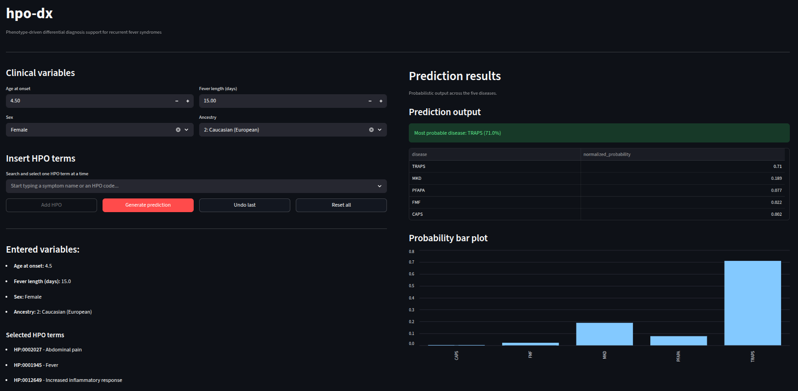

# hpo-dx


**hpo-dx** is a phenotype-driven clinical decision support prototype for the differential diagnosis of hereditary recurrent fever syndromes.

The application leverages Human Phenotype Ontology (HPO) terms, demographic variables, and machine learning models to estimate the probability of five autoinflammatory diseases:

- CAPS
- FMF
- MKD
- PFAPA
- TRAPS

The current implementation uses supervised machine learning models trained on curated clinical datasets, incorporating ontology-aware feature expansion via HPO ancestor propagation.

### GUI preview
<p align="center">
  
</p>

---

## Features

- Interactive Streamlit interface
- HPO-based phenotype input with ontology expansion
- Integration of clinical variables (age at onset, fever length, gender, ethnicity)
- One-vs-Rest probabilistic classification
- Interpretable output with ranked probabilities and visualization

---

## Research-use prototype

**hpo-dx is a research prototype intended for exploratory and decision-support use only.**

- It is **not a medical device**.
- It must **not be used as a standalone tool** for diagnosis, treatment, or patient management.
- Outputs should always be interpreted by qualified clinicians in the context of full clinical evaluation.

The current version has been developed and evaluated on the datasets described in the associated manuscript and **has not yet been externally validated** on independent cohorts.

---

## Model artifacts

Pretrained model artifacts (`.joblib`) are not distributed with the public repository.

The repository currently includes:
- preprocessing pipeline
- ontology integration
- inference framework
- Streamlit application interface

but not trained model weights.


## Usage
```bash
pip install -r requirements.txt
streamlit run app/home.py
```

---

## Python version

This project has been developed and tested with Python 3.13.
Compatibility with earlier versions (e.g., 3.10–3.12) is expected but not guaranteed.

---

## Methodological note

The current implementation includes:

- HPO-based phenotypic encoding
- Ontology-aware ancestor propagation
- One-vs-Rest probabilistic classification
- Feature normalization using training-set statistics
- Phenotype vector expansion using HPO hierarchical relationships

---

## Acknowledgment and attribution

This project uses the Human Phenotype Ontology (HPO) to represent phenotypic abnormalities and ontology-derived relationships.

We gratefully acknowledge the Human Phenotype Ontology project and its contributors.

HPO website: https://hpo.jax.org

---

## References

*(under review)* Cavalca G & Matucci-Cerinic C, et al.
Machine learning-based validation of Human Phenotype Ontology (HPO) terms for systemic autoinflammatory diseases using the Eurofever Registry: the ODINO project.

---

## License
See LICENSE file.